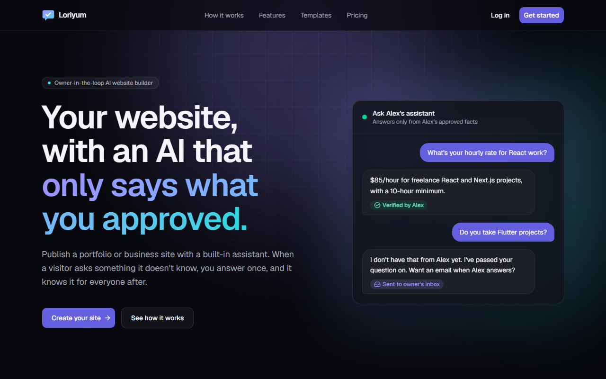
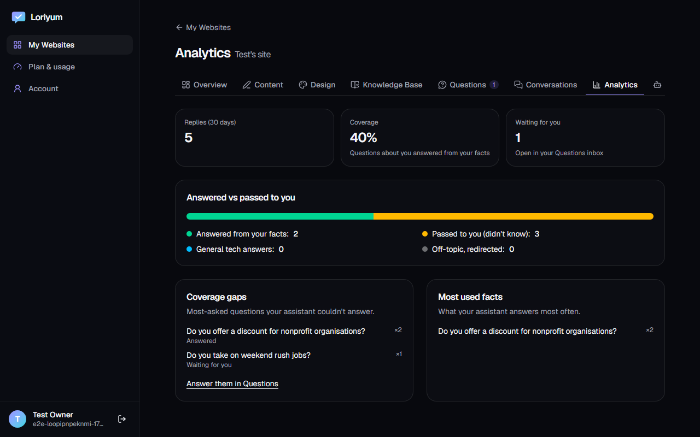
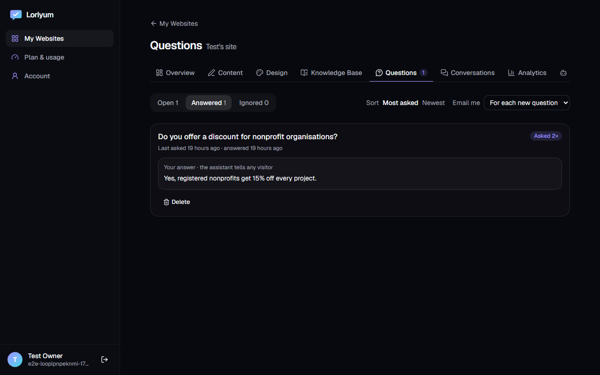
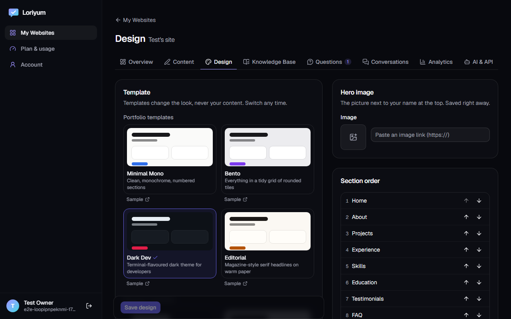
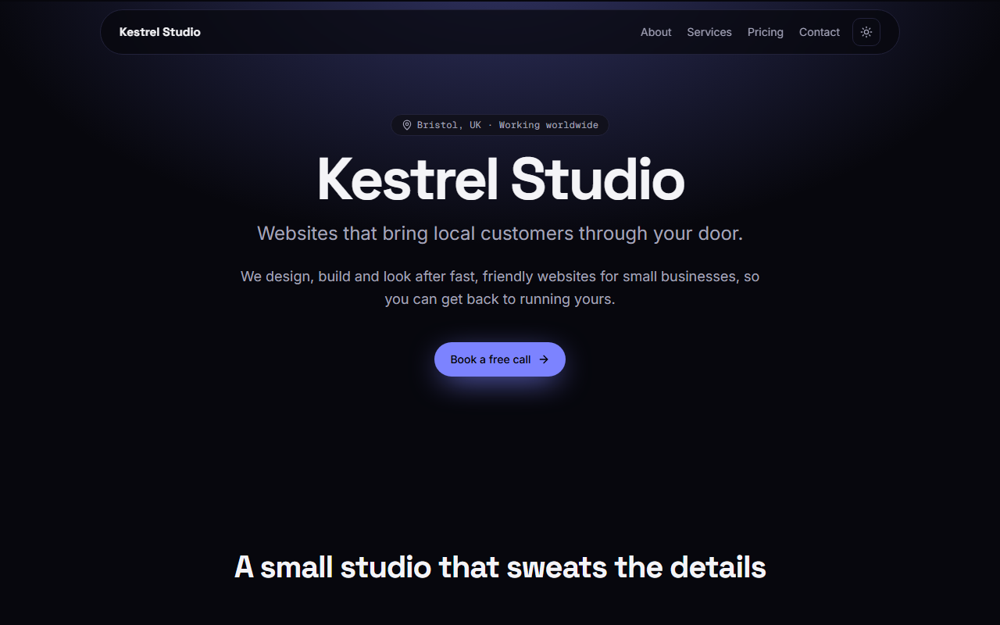
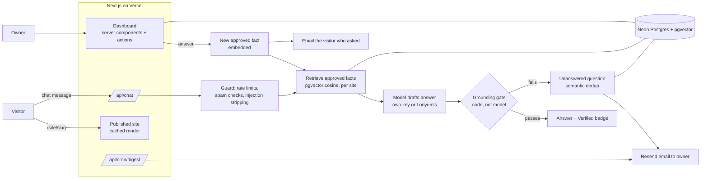

# Loriyum

**An owner-in-the-loop AI website builder.** Publish a portfolio or business site with a built-in
chatbot that answers **only** from facts the owner approved. When a visitor asks something it
doesn't know, the question goes to the owner's inbox; the owner answers once, and the assistant
knows it for every visitor after that (and emails the person who asked).



## The Golden Rule

> The chatbot must never state an owner-specific fact that is not in that site's approved
> knowledge base.

The model proposes; **code decides**. An owner-fact answer is only shown when every check in
the grounding gate passes: the question is about the owner, the best retrieved fact is similar
enough, every fact the model cites was actually retrieved, and every number in the answer
appears in those facts. Anything else gets a fixed "I don't have that yet" reply and goes to the
owner's inbox. Details: [docs/chat-grounding.md](docs/chat-grounding.md).

## Features

- **Wizard → live site in minutes:** 8 templates (4 portfolio, 4 business), content editor with
  autosave, image uploads, publish to `/site/your-name`.
- **Design tab:** switch templates without losing content; accent colour, 6 font pairs,
  light/dark default, section order, hero image, SEO title and description, share images.
- **Knowledge base:** add facts by hand, from a pasted resume or a `.txt` file (AI suggests, the
  owner approves), private facts, expiry dates, conflict hints when two facts disagree.
- **Questions inbox:** unanswered questions deduplicated by meaning, merge/ignore/delete,
  AI-drafted replies from existing facts, public or private answers, email to the asker.
- **AI & API:** Loriyum's AI on a (simulated) plan with monthly quotas, or the owner's own
  Google / OpenAI / Anthropic key, encrypted with AES-256-GCM.
- **Workspace:** overview with private visit counts, conversation transcripts, visitor emails
  (CSV), analytics (answered vs passed on, coverage gaps), chatbot name/greeting/tone/colours.
- **Account:** export all data as JSON, delete the account.

| Analytics                                              | Questions inbox                                                    |
| ------------------------------------------------------ | ------------------------------------------------------------------ |
|  |              |
| **Design tab**                                         | **Template: SaaS Launch**                                          |
|        |  |

## Architecture



- **One Next.js app** (App Router, Cache Components) for the marketing pages, dashboard,
  public sites and API. Published sites render from database content and are cached per site;
  edits revalidate the cache tag.
- **Sites are JSON sections** validated with Zod; templates are CSS themes over one shared set of
  section components, so switching templates never touches content.
- **Embeddings always use one fixed platform model** (`gemini-embedding-001`, 768 dims) so
  search works whichever model answers.
- **Every query is scoped** to the signed-in owner (or to a published site for public routes),
  with ownership tests for each.

## Tech stack

Next.js 16 · React 19 · TypeScript (strict) · Tailwind CSS 4 · shadcn/ui · Motion · Neon Postgres

- pgvector · Drizzle ORM · Better Auth · Vercel AI SDK (Google, OpenAI, Anthropic) · Zod ·
  Resend · Vercel Blob · Sentry · Vitest · Playwright.

## Run it locally

Requirements: Node 22+ and npm.

```bash
npm install
cp .env.example .env.local
```

Edit `.env.local`. The minimum is:

- `DATABASE_URL`: a Neon connection string, **or** `pglite:./.local-db` to use a built-in local
  Postgres (no account needed).
- `BETTER_AUTH_SECRET`: any random string of 32+ characters
  (`openssl rand -base64 32`).

Optional: `GOOGLE_GENERATIVE_AI_API_KEY` (chat and suggestions), `RESEND_API_KEY` (real emails;
without it emails are saved to `.local-outbox/`), `BLOB_READ_WRITE_TOKEN` (image uploads),
`API_KEY_ENCRYPTION_KEY` (owners' own AI keys), `CRON_SECRET`, `NEXT_PUBLIC_SENTRY_DSN`. Every
variable is explained in [.env.example](.env.example).

```bash
npm run db:migrate   # create the tables
npm run dev          # http://localhost:3000
```

## Tests

```bash
npm run typecheck
npm run lint
npm test             # unit tests (real migrations on an in-memory Postgres)
npm run test:e2e     # Playwright against a production build
npm run eval         # chatbot answer-quality eval against the real model (needs an AI key)
```

The end-to-end suite covers sign-up → build → publish → chat → unknown question → owner answers →
next visitor gets the answer → the first visitor is emailed.

## Deploy

Import the GitHub repo in Vercel and add the environment variables from `.env.example`.
`vercel-build` runs database migrations before every build. See
[docs/security-review.md](docs/security-review.md) for the security checklist.

## Project docs

- [CLAUDE.md](CLAUDE.md): rules and architecture decisions.
- [BUILD_PLAN.md](BUILD_PLAN.md): phases, checklists and the decision log.
- [docs/chat-grounding.md](docs/chat-grounding.md): how the chatbot stays truthful.
- [docs/security-review.md](docs/security-review.md): security review.
